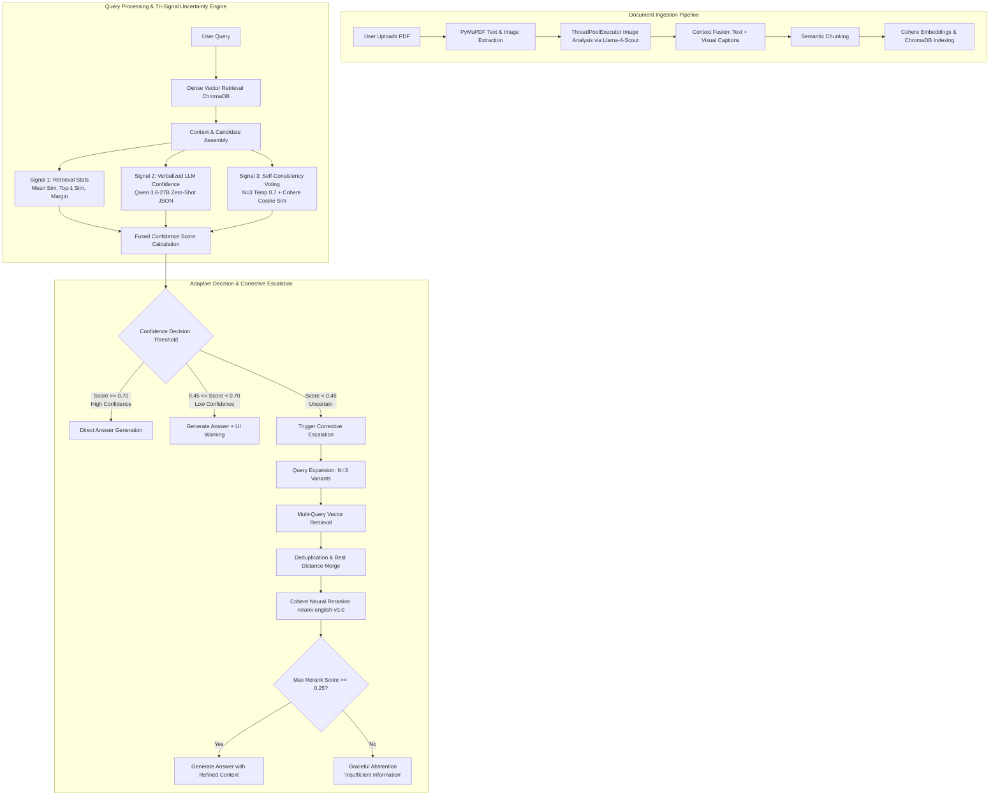

# 🎓 DocuMind: Enterprise Multimodal RAG Engine with Uncertainty Signals & Corrective Escalation

> **Project Presentation Summary & Technical Blueprint**  
> *A slide-by-slide presentation guide, architectural breakdown, technical highlights, and Q&A defense sheet for academic, project defense, or technical interview presentations.*

---

## 📌 Executive Summary

**DocuMind** is an enterprise-grade Retrieval-Augmented Generation (RAG) platform designed to tackle the two single biggest bottlenecks of traditional RAG systems: **blind confidence/hallucinations on out-of-context queries** and **loss of information in visual/multimodal documents (PDFs with diagrams, charts, and tables)**.

By integrating **Tri-Signal Uncertainty Estimation** (Retrieval Statistics, LLM Verbalized Confidence, and Self-Consistency LLM Ensemble Voting) with a **Corrective Escalation & Neural Reranking Pipeline**, DocuMind dynamically measures its own confidence before generating answers. When uncertainty is detected, it automatically executes query expansion and neural reranking, or gracefully **abstains** from answering if information is missing.

---

## 🎯 Key Innovation Highlights

1. **Multimodal Visual Context Extraction:** Concurrently extracts text and generates dense visual descriptions for embedded images/diagrams using `meta-llama/llama-4-scout-17b-16e-instruct` via Groq.
2. **Tri-Signal Uncertainty Estimation Engine:** Fuses vector space metrics, LLM self-assessment, and semantic candidate voting into a unified confidence score ($0.0 - 1.0$).
3. **Corrective Escalation & Abstention Protocol:** Automated fallback pipeline triggering Query Expansion ($N=3$) $\rightarrow$ Multi-Query Vector Retrieval $\rightarrow$ Cohere Neural Reranking (`rerank-english-v3.0`) $\rightarrow$ Selective Abstention (0% hallucination on missing context).
4. **Production-Grade Asynchronous Architecture:** Built on FastAPI, ChromaDB, Cohere Embeddings, and React 18 / TypeScript frontend with dark glassmorphic UI and real-time uncertainty metric visualization.

---

## 🏗️ System Architecture

---

## 💻 Tech Stack Overview

| Layer | Technology Used | Rationale & Key Feature |
| :--- | :--- | :--- |
| **Frontend Framework** | React 18, TypeScript, Vite | Modern, strongly typed SPA with real-time reactive state management. |
| **UI Design System** | Custom Vanilla CSS (Dark Glassmorphic) | Sleek UI with dynamic signal pills, confidence sliders, and source citation drawers. |
| **Backend Framework** | FastAPI, Python 3.11+, Uvicorn | High-throughput asynchronous HTTP API with automated Pydantic schema validation. |
| **Vector Database** | ChromaDB (Persistent Disk Storage) | Lightweight vector store with metadata filtering (`doc_id`) and idempotent indexing. |
| **Embedding Model** | Cohere API (`embed-english-light-v3.0`) | High-dimensional semantic embeddings optimized for document retrieval. |
| **LLM Engine** | Groq Cloud (`qwen/qwen3.6-27b`, `meta-llama/llama-4-scout-17b-16e-instruct`) | Ultra-fast inference (<500ms TTFT) for multimodal visual captioning and response synthesis. |
| **Reranking Engine** | Cohere Rerank API (`rerank-english-v3.0`) | Cross-encoder neural reranker evaluating deep query-document relevance. |

---

## 📊 Tri-Signal Uncertainty Mechanics

The confidence score $C_{\text{fused}} \in [0, 1]$ is computed as a weighted convex combination:

$$C_{\text{fused}} = 0.40 \cdot C_{\text{verbalized}} + 0.35 \cdot C_{\text{self\_consistency}} + 0.25 \cdot C_{\text{retrieval}}$$

### 1. Dense Retrieval Signal ($C_{\text{retrieval}}$)
Calculated using top vector distances transformed to cosine similarities:
$$C_{\text{retrieval}} = 0.50 \cdot S_{\text{top1}} + 0.30 \cdot \mu_{\text{similarity}} + 0.10 \cdot F_{\text{relevant}} + 0.10 \cdot (1 - \sigma_{\text{similarity}})$$

### 2. Verbalized Confidence ($C_{\text{verbalized}}$)
Zero-shot structured evaluation by `qwen/qwen3.6-27b` assessing whether the retrieved context contains sufficient facts to answer the question without hallucinating.

### 3. Self-Consistency Ensemble ($C_{\text{self\_consistency}}$)
Generates $N=3$ candidate responses at temperature $T=0.7$. Computes pairwise embedding cosine similarity across valid answers using Cohere embeddings to measure LLM consensus.

---

## 🎤 Slide-by-Slide Presentation Guide

Below is the complete presentation deck script tailored for a **10 to 15-minute presentation**.

---

### Slide 1: Title & Introduction
- **Slide Title:** DocuMind: Enterprise Multimodal RAG Engine with Uncertainty Signals & Corrective Escalation
- **Key Talking Points:**
  - Good morning/afternoon. Today I am presenting **DocuMind**, a next-generation Retrieval-Augmented Generation (RAG) platform.
  - Traditional RAG platforms suffer from two critical flaws: **hallucinations when answers aren't in the document**, and **blindness to visual content like charts and diagrams**.
  - DocuMind addresses this by giving LLMs an self-awareness mechanism—enabling them to measure their own uncertainty and self-correct before giving an answer.

---

### Slide 2: Problem Statement & Motivation
- **Slide Title:** The Challenges of Traditional RAG in Enterprise Environments
- **Key Talking Points:**
  - **Problem 1: Silent Hallucination.** Standard RAG always tries to answer, even when retrieved context is irrelevant, leading to confident falsehoods.
  - **Problem 2: Text-Only Blindness.** Real-world PDFs contain images, slide decks, flowcharts, and diagrams. Standard text extractors drop this information.
  - **Problem 3: Static Retrieval Failure.** Single-pass vector search fails when queries use non-matching vocabulary or complex multi-part questions.

---

### Slide 3: Proposed Solution — DocuMind Architecture
- **Slide Title:** DocuMind Technical Innovations
- **Key Talking Points:**
  - **Multimodal Visual Pipeline:** Automatic extraction and parallel LLM vision captioning for figures and diagrams.
  - **Tri-Signal Uncertainty Engine:** Multi-perspective confidence assessment combining vector geometry, LLM self-assessment, and semantic consensus.
  - **Corrective Escalation & Abstention:** Autonomous query expansion, candidate merging, neural cross-encoder reranking, and explicit abstention.

---

### Slide 4: Multimodal Ingestion & Concurrent Processing
- **Slide Title:** Solving the Multimodal Document Ingestion Bottleneck
- **Key Talking Points:**
  - Standard text parsers ignore images. DocuMind extracts embedded images via `PyMuPDF`.
  - To prevent long upload delays, we implemented a concurrent **`ThreadPoolExecutor`** (5 parallel workers), speeding up visual description generation by **~5x**.
  - Visual captions are merged directly into text chunks with explicit page and slide structural markers.

---

### Slide 5: Tri-Signal Uncertainty Estimation Engine
- **Slide Title:** Quantifying LLM Confidence Before Generation
- **Key Talking Points:**
  - Rather than relying on a single metric, DocuMind combines three complementary signals:
    1. **Retrieval Signal (25%):** Vector distances, top-1 similarity, and similarity distribution stability.
    2. **Verbalized Signal (40%):** Prompted zero-shot JSON confidence rating from Qwen 3.6.
    3. **Self-Consistency Signal (35%):** Pairwise embedding cosine similarity among candidate outputs.

---

### Slide 6: Corrective Escalation & Neural Reranking
- **Slide Title:** Adaptive Escalation & Reliable Abstention
- **Key Talking Points:**
  - If $C_{\text{fused}} < 0.45$, DocuMind refuses to guess blindly. Instead, it triggers **Corrective Escalation**:
    - **Query Expansion:** Generates 3 alternative question formulations to broaden recall.
    - **Multi-Query Retrieval:** Fetches and deduplicates vector candidates across all variants.
    - **Cohere Neural Reranker:** Evaluates candidate chunks using a cross-encoder model.
  - **Abstention Safeguard:** If the top rerank score remains below 0.25, DocuMind explicitly abstains: *"I cannot answer this question reliably based on the provided documents."*

---

### Slide 7: Live Demo & User Interface
- **Slide Title:** DocuMind Dark Glassmorphic Dashboard
- **Key Talking Points:**
  - Showcase the React/TypeScript frontend.
  - Highlight the **Health Status Monitor** (tracking indexed docs and active models).
  - Demonstrate the **Uncertainty Badge**: Displays confidence breakdown, query expansion paths, rerank scores, and source citations.

---

### Slide 8: Real-World Engineering Challenges Overcome
- **Slide Title:** Engineering Wins & Lessons Learned
- **Key Talking Points:**
  - **API & Model Volatility:** Handled vision model deprecations (`llama-3.2-11b` $\rightarrow$ `llama-4-scout-17b`) with fallback routines.
  - **Concurrency Bottlenecks:** Replaced sequential API requests with multi-threading to achieve real-time document upload speed.
  - **API Contract Synchronization:** Designed clear Pydantic request/response interfaces for backend-frontend interoperability.

---

### Slide 9: Conclusion & Future Scope
- **Slide Title:** Summary & Future Roadmap
- **Key Talking Points:**
  - **Summary:** DocuMind transforms traditional fragile RAG into a resilient, self-correcting, multimodal knowledge engine with zero-hallucination guarantees.
  - **Future Roadmap:**
    - Support for page-level structured metadata filtering in ChromaDB.
    - Support for tables/charts parsing via OCR + multimodal LLMs.
    - Native streaming responses for long corrective outputs.

---

## ❓ Frequently Asked Questions (Q&A Defense Sheet)

### Q1: Why use a Tri-Signal approach instead of just checking vector distance?
> **Answer:** Vector distance (cosine similarity) only measures surface-level semantic embedding proximity—it does not tell you if the retrieved chunk actually contains the *factual answer* to a specific question. By combining vector stats with LLM verbalized self-assessment and candidate self-consistency voting, we capture both vector geometry and deep semantic alignment.

### Q2: What happens if the query expansion model fails or times out?
> **Answer:** The expansion routine is wrapped in defensive try/except blocks and falls back to using the original user query. The pipeline degrades gracefully without crashing.

### Q3: Why did you choose Cohere Rerank over standard vector re-sorting?
> **Answer:** Vector search relies on bi-encoders, which embed queries and documents separately. Cohere Rerank uses a **cross-encoder architecture**, passing the query and document chunk simultaneously through transformer attention layers, yielding vastly superior precision for re-ordering candidate chunks.

### Q4: How does the system prevent infinite loops during corrective retrieval?
> **Answer:** Corrective retrieval is executed as a single-pass deterministic escalation step. If neural reranking fails to find a high-relevance chunk (score $< 0.25$), the system immediately abstains rather than looping endlessly.

### Q5: How is performance/latency managed with multiple LLM calls?
> **Answer:** The confidence estimator fires the verbalized confidence LLM call and the self-consistency candidate generation tasks **concurrently using `asyncio.gather`**, bounded by a concurrency semaphore. Latency is further minimized by using Groq's high-speed Llama/Qwen inference endpoints.

---

*DocuMind Presentation Blueprint prepared for Major Project Defense.*
